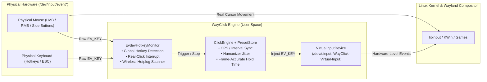

<p align="center">
  
</p>

<h1 align="center">WayClick</h1>

<p align="center">
  <strong>Wayland-Native, Kernel-Level GUI Auto Clicker &amp; Key Presser for Linux</strong>
</p>

<p align="center">
  
  
  
  
  
</p>

---

## 📖 Overview

**WayClick** is a lightweight, zero-daemon GUI auto clicker and keyboard auto-presser built specifically for modern **Wayland desktops** (KDE Plasma, GNOME, Hyprland, Sway), **XWayland**, and **fullscreen Steam / Proton / Wine games**.

Unlike legacy X11 auto clickers (`xdotool`, `pynput`, `XAutoClick`) that break on Wayland due to compositor window isolation, WayClick operates directly at the **Linux kernel input layer** (`evdev` + `uinput`). Because it separates physical hardware device streams from its own virtual kernel device, WayClick can even **distinguish a real physical mouse click from its own synthetic clicks at 500 CPS**—allowing you to stop auto-clicking immediately just by clicking your real mouse.

---

## 🧠 How It Works (Architecture & ELI5)

On Wayland, applications are isolated for security: one window cannot spy on your global keystrokes or inject artificial clicks into another window (especially fullscreen games).

WayClick solves this cleanly without requiring `root` or background root daemons:



1. **Global Hotkey & Real-Click Detection (`evdev`)**: WayClick reads raw hardware events directly from `/dev/input/event*`. It hears your global toggle/hold key (`F6`, mouse side buttons, etc.) inside any fullscreen game and automatically rescans when wireless mice/keyboards wake from sleep.
2. **Hardware-Level Click & Key Injection (`uinput`)**: WayClick creates a virtual kernel device (`/dev/uinput`) named `WayClick-Virtual-Input` declaring both pointer (`EV_REL` + `EV_KEY`) and keyboard capabilities so `libinput`, Wayland compositors, and games treat every synthetic action as genuine hardware input.
3. **100% Real-vs-Synthetic Click Separation**: Because `EvdevHotkeyMonitor` explicitly filters out `WayClick-Virtual-Input`, WayClick never hears its own synthetic clicks—meaning a single physical click on your real mouse can immediately interrupt and stop a 500 CPS auto-click stream.

---

## ✨ Key Features

| Category | Feature Description |
| :--- | :--- |
| **🎯 Mouse & Keyboard Support** | Auto-click **Left (`LMB`)**, **Right (`RMB`)**, **Middle (`MMB`)**, **Mouse Back (`MB4`)**, or **Mouse Forward (`MB5`)** (single or double-click per cycle), or switch to **Keyboard Key Auto-Presser** and record *any* physical key. |
| **🎮 App & Game Presets** | Create, save, rename, and switch between custom presets for different games and apps (e.g., *Stardew Valley*, *Minecraft*, *Euro Truck Simulator 2*). Includes 4 built-in starter presets. |
| **🛑 Stop on Real Physical Click** | Distinguishes physical hardware clicks from synthetic `uinput` clicks—allowing any real mouse click (`LMB`/`RMB`/`MMB`) to immediately stop auto-clicking. |
| **⭕ Zero-Drift Cursor Countdown Ring** | Clicking the GUI Start button displays a smooth 60 FPS circular countdown ring & timer badge locked 1:1 around your cursor across multi-monitor fractional HiDPI (`125%` / `150%`) setups while you move to your target window. |
| **⚡ Synced CPS & Interval + Hold Time** | Adjust **Rate (0.05–500 CPS)** or **Interval (ms)**—both stay synchronized automatically. Configurable **Press Hold Time** (default `15 ms`, ~1 frame at 60 FPS) ensures games never miss inputs between frames. |
| **🎲 Humanizer (Random Jitter)** | Adds randomized $\pm\text{ms}$ timing variance to both cycle intervals and button hold durations, with a live effective CPS range calculator. |
| **⌨️ Global Hotkey: Toggle & Hold Modes** | Bind any keyboard key or mouse side button (`MB4`/`MB5`). Run in **Toggle Mode** (press once to start, again to stop) or **Hold Mode** (rapid-fire only while the button is held down). |
| **🛡️ Anti-Trap & Panic Safeguards** | **Hardware-Verified GUI Button** ignores synthetic clicks hovering over the Start/Stop button, plus an always-active **`ESC` Emergency Stop** key and guaranteed key-release (`0`) on stop so buttons never stick. |
| **📥 System Tray Integration** | Minimizes cleanly to the system tray with a dynamic green active-status badge, quick Start/Stop toggle, and instant Game Preset switching from the tray menu. |
| **🧹 Strict Clean System Policy** | Self-contained directory structure: all settings and presets save locally to `./config.json` with zero `~/.config` clutter and a 1-command clean uninstaller. |

---

## 🛠️ Prerequisites & Permissions

WayClick requires **Python 3.10+**, `python3-evdev`, and `python3-pyqt6`:

### 1. Install Python Packages

- **Fedora / Nobara:**
  ```bash
  sudo dnf install python3-evdev python3-pyqt6
  ```
- **Arch Linux / CachyOS:**
  ```bash
  sudo pacman -S python-evdev python-pyqt6
  ```
- **Ubuntu / Debian / Linux Mint:**
  ```bash
  sudo apt install python3-evdev python3-pyqt6
  ```

### 2. Enable Non-Root `input` & `uinput` Access

*(Note: Gaming distros like **Nobara Linux** often configure `/dev/uinput` ACLs automatically).*
If your user cannot read `/dev/input/event*` or write to `/dev/uinput`, add your user to the `input` group and create a `uinput` udev rule:

```bash
sudo usermod -aG input "$USER"
echo 'KERNEL=="uinput", SUBSYSTEM=="misc", TAG+="uaccess", OPTIONS+="static_node=uinput", GROUP="input", MODE="0660"' | sudo tee /etc/udev/rules.d/99-wayclick-uinput.rules
sudo udevadm control --reload-rules && sudo udevadm trigger
```
*(Log out and back in once for group changes to apply).*

---

## 🚀 Quick Start

### Clone & Run Directly
```bash
git clone https://github.com/korgangames/WayClick.git
cd WayClick
./run.sh
```

### Add to Desktop Application Menu / KRunner (Optional)
To install the custom icon and launcher into `~/.local/share/applications`:
```bash
./install-desktop-shortcut.sh
```

---

## 🧹 Clean Uninstall

WayClick follows a strict **Zero Leftover Clutter Policy**.

- **Remove Desktop Shortcut & Reset Local Config:**
  ```bash
  ./uninstall.sh
  ```
- **Purge Everything (Shortcut, Icons, Config, and Project Directory):**
  ```bash
  ./uninstall.sh --purge-all
  ```

---

## 📄 License

Distributed under the **MIT License**. See [`LICENSE`](LICENSE) for full details.
